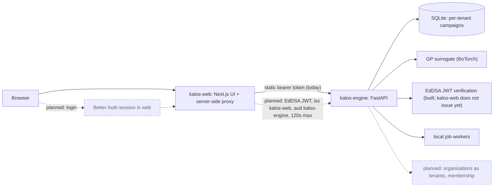

# Kalos engine

> **Status: under development. Not a public SaaS.**
> Kalos is a scientific optimization platform. It is being built toward a public SaaS.
> There is no hosted service today. User login and organization management are under development. They are **not** on `main`.
> The optimizer is **not scientifically validated**. See [Scientific methodology](#scientific-methodology-and-benchmark-limitations).
> Nothing here claims enterprise readiness, regulatory compliance, or security certification.

## Contents

- [Overview](#overview) · [Related repositories](#related-repositories) · [Target users](#target-users-and-use-cases)
- [Capabilities](#capabilities) · [Architecture](#architecture)
- [Local development](#local-development) · [API](#api) · [Security model](#security-model)
- [Scientific methodology](#scientific-methodology-and-benchmark-limitations) · [Benchmark vs other optimizers](#benchmark-vs-other-optimizers)
- [Limitations](#current-limitations) · [Roadmap](#roadmap) · [Deploy](#deploy-and-operate)
- [Data policy](#data-policy) · [Stack & cost](#stack-and-cost) · [Repository layout](#repository-layout) · [Contributing](#contributing)

## Overview

Kalos proposes the next batch of experiments for a bioprocess campaign. A campaign runs in rounds of three steps — **propose, measure, re-propose** — and Kalos drives the propose step.

**What you give it.** A run sheet of past runs (CSV, TSV, or Excel) and the name of a target column, such as titer or yield.

**What it does.** Kalos checks the data, then runs Bayesian optimization (BO): it fits a *surrogate model* — a fast statistical approximation of the process — as a Gaussian process (GP) using BoTorch (a PyTorch library for BO). The GP also reports *uncertainty* (how far a prediction may be wrong). An *acquisition function* scores each candidate experiment, and Kalos uses those scores to choose the batch.

**What you get back.** A proposed batch of recipes, plus the diagnostics you need to judge how far to trust it. You run the experiments, log the measured results, and ask for the next batch.

**Scale-up readout (separate feature).** Predicts performance at a larger scale, and *refuses to predict* when its backtest — a check of past predictions against known results — does not support it.

This repository is the engine: a **FastAPI service with no built-in UI**. The scientist-facing workbench is the separate [kalos-web](https://github.com/itsbrendandang/kalos-web) repository.

## Related repositories

Kalos is three repositories with a clear split:

- **kalos-engine** (here) — the optimization engine and its FastAPI service.
- **[kalos-web](https://github.com/itsbrendandang/kalos-web)** — the scientist-facing workbench. The browser talks to it; its server-side proxy forwards to this engine over HTTP with a short-lived token. The response fields it depends on are guarded here by `tests/test_web_contract.py`.
- **kalos-workspace** (private) — the project hub: working notes, reviews, research, plans, and the cross-machine handoff. No product code.

## Target users and use cases

Intended users. The product is not yet available to external users.

- **Bioprocess scientists and process-development teams.** They have a spreadsheet of runs (media, feeds, pH, temperature). They want a suggested next round. They also want a candid assessment of what the data can support.
- **Small teams that run iterative campaigns** (propose, measure, re-propose). They have a few dozen to a couple of thousand runs. The exact GP is capped at 2,000 fit rows (`KALOS_MAX_FIT_ROWS`).
- **Platform or machine learning (ML) engineers.** They want a tenant-aware optimization API that they can self-host. A tenant is one data owner.

Use cases:

- Next-batch proposals for media or process optimization.
- Tracking an in-flight campaign. In-flight runs have started but are not yet measured.
- A scale-up readout from a multi-scale run sheet.

These are not use cases yet:

- Regulated work under good practice rules (GxP).
- Work that depends on the optimizer being validated against real wet-lab outcomes.

## Capabilities

Status labels:

- **IMPLEMENTED**: on `main`, with tests.
- **EXPERIMENTAL**: on `main` or in an open pull request (PR). It is not validated, or it is opt-in.
- **PLANNED**: not built.

An open PR is listed as in progress. It is not listed as implemented.

Latin hypercube sampling (LHS) spreads random points evenly across the design space.

| Capability | Status | Evidence |
| --- | --- | --- |
| Upload a CSV, TSV, or Excel file. Validate, analyze, and propose the next batch (`POST /api/run`) | IMPLEMENTED | `kalos/portal/app.py`, `docs/UPLOADS.md`, `tests/test_validation_gate.py` |
| GP surrogate model (BoTorch) for mixed continuous and categorical design spaces | IMPLEMENTED | `kalos/core/`, `tests/test_data_and_core.py` |
| Grouped cross-validation (CV). Split-conformal bands (intervals calibrated on held-out data). Fail-closed promotion gates (a failing check blocks promotion) | IMPLEMENTED | `kalos/core/splits.py`, `conformal.py`, `gates.py`; `tests/test_calibration.py`, `tests/test_promotion_and_baselines.py` |
| Data validation gate. It checks units, bounds, duplicates, and missing values | IMPLEMENTED | `kalos/validation/`, `tests/test_validation_gate.py` |
| Campaign loop (propose, measure, re-propose) with in-flight points | IMPLEMENTED | `kalos/portal/campaign_routes.py`, `docs/CAMPAIGN_LOOP.md`, `tests/test_pending_proposals.py` |
| Scale-up readout. It refuses when its backtest fails | IMPLEMENTED (synthetic evidence only) | `kalos/portal/scale_routes.py`, `docs/SCALE_READOUT.md`, `docs/SCALE_EVIDENCE.md` |
| Bearer-token authentication (a secret string that grants access) with `read`/`write`/`admin` scopes. Tokens are hashed | IMPLEMENTED | `kalos/portal/auth.py` |
| Campaign and latest-analysis store, keyed by tenant (SQLite) | IMPLEMENTED | `kalos/portal/campaign.py`, `docs/HARDENING.md` Phase 1b |
| Upload limits. Loopback-only default (loopback means this machine only). Remote requests are refused when the API is open | IMPLEMENTED | `kalos/portal/uploads.py`, `__main__.py`, `app.py` middleware |
| Container deploy pack | IMPLEMENTED (limited verification, see runbook; no CI runs today, use `scripts/check.sh`) | `deploy/` |
| Optimizer beats LHS/random on synthetic surfaces | IMPLEMENTED as a benchmark; not validation | `BENCHMARK.md`, `python -m kalos.bench` |
| Head-to-head against random, LHS, Optuna TPE, Ax, and vanilla GP-EI on synthetic tasks | IMPLEMENTED as a benchmark; not validation | [Benchmark vs other optimizers](#benchmark-vs-other-optimizers), `docs/BENCHMARK.md`, `benchmarks/results/` |
| Mechanistic (Monod) prior mean | EXPERIMENTAL, opt-in, simulation benchmark only | `kalos/core/mechanistic.py`, `examples/mechanistic_benchmark.py` |
| Pool-replay benchmark (the optimizer picks from a fixed pool of measured rows) on published media datasets | EXPERIMENTAL; datasets are private and not in the repo | `kalos/bench/amii.py`, `examples/amii_benchmark.py` |
| Hard linear constraints on proposals | IMPLEMENTED in the core API only (`propose_batch`); the HTTP API and portal do not expose them yet | `kalos/core/optimize.py`, `tests/test_linear_constraints.py` |
| `feature_ranges` in analysis output. GP-default guardrail | IMPLEMENTED | `kalos/portal/analysis.py`, `tests/test_feature_ranges.py` |
| Repository hygiene (CODEOWNERS, SECURITY.md, PR template). Loopback-by-default compose bind | IMPLEMENTED | `SECURITY.md`, `.github/CODEOWNERS`, `deploy/compose.yaml` |
| Engine-side verification of short-lived internal JSON Web Tokens (JWTs) from the web app (EdDSA) | IMPLEMENTED (kalos-web does not issue them yet) | `kalos/portal/jwt_auth.py`, `docs/ENGINE_TOKEN.md`, `tests/test_jwt_auth.py`; PRs [#88](https://github.com/itsbrendandang/kalos-engine/pull/88), [#96](https://github.com/itsbrendandang/kalos-engine/pull/96) |
| Organizations as tenants, with membership | PLANNED | the engine only reads a `tenant` string (from an operator-provisioned token or an engine JWT claim). No organization model or membership exists in the engine |
| Multiple campaigns per tenant | IMPLEMENTED | `kalos/portal/campaigns_api.py`, `docs/CAMPAIGNS_API.md`, `tests/test_cross_tenant_isolation.py`; PRs [#89](https://github.com/itsbrendandang/kalos-engine/pull/89), [#90](https://github.com/itsbrendandang/kalos-engine/pull/90) |
| Background analysis jobs with a local worker process (`/api/campaigns/{id}/jobs`) | IMPLEMENTED | `kalos/portal/jobs.py`, `job_runner.py`, `job_worker.py`, `docs/JOBS.md`, `tests/test_jobs.py`, `tests/test_jobs_api.py`; PR [#91](https://github.com/itsbrendandang/kalos-engine/pull/91). The synchronous routes still return 503 busy when the analysis slot is taken |
| Sparse/variational surrogate model beyond 2,000 rows | PLANNED | `docs/HARDENING.md` Phase 2 |
| Metrics, structured logging, alert hooks | PLANNED | `docs/HARDENING.md` Phase 3 |
| Scientific validation on independent real wet-lab data | PLANNED | not done; see below |

## Architecture

Solid arrows and boxes exist on `main`. Dashed arrows and boxes are planned. They are not implemented.



Today, the browser talks to the Next.js app. The app's server-side proxy forwards requests to this engine. It uses one configured bearer token.
The web app has **no user login**. So anyone who can reach the proxy acts as that token's tenant.

The engine side has these parts, which are built:

- Verification of short-lived EdDSA-signed internal JWTs. The engine checks them on its own. Issuer `kalos-web`, audience `kalos-engine`, lifetime of at most 120 seconds.
- Multiple campaigns per tenant.
- Background analysis jobs, run by local worker processes.

These parts are still planned:

- The Better Auth session and JWT issuance in the web app.
- Organizations as tenants, with membership.

Current and planned request flows: [`docs/ARCHITECTURE.md`](docs/ARCHITECTURE.md). Campaign loop details: [`docs/CAMPAIGN_LOOP.md`](docs/CAMPAIGN_LOOP.md).

## Local development

Python 3.11 or later is needed. All tools are free and open source.

```bash
python -m pip install -e .               # core, torch-free
python -m pip install -e ".[ml,portal]"  # + BoTorch and the FastAPI service
python -m kalos.portal                   # http://127.0.0.1:8050 (KALOS_HOST / KALOS_PORT to change)
```

The core install does not use torch (PyTorch). It installs `numpy`, `pandas`, `scikit-learn`, and `scipy`. This is enough for `kalos.kit`.

In a second shell, upload the synthetic example. The example is generated by `examples/synthetic_bioprocess/make_synthetic.py`. It is not measured data.

```bash
curl -F file=@examples/synthetic_bioprocess/synthetic_bioprocess.csv http://127.0.0.1:8050/api/run
curl http://127.0.0.1:8050/api/latest
```

Both commands were run on a fresh install of this branch's code. `/healthz` returned ok. The upload returned a 10-feature analysis for 160 rows.
State is written to `~/.kalos`. Set `KALOS_STATE_DIR` to change the location.
With no tokens configured, the API is open on loopback only. See Security model.

Run these checks. They are the same as CI:

```bash
python -m pip install -e ".[ml,portal,bench,dev]"
ruff check kalos/ tests/ examples/
mypy
python -m pytest -q    # 804 tests collected at the time of writing
```

## API

Routes are defined in `kalos/portal/app.py`, `campaign_routes.py`, `campaigns_api.py`, `jobs_api.py`, and `scale_routes.py`.
The legacy `/api/campaign*` routes act on one default campaign per tenant. The `/api/campaigns/*` routes are the multi-campaign API (many campaigns per tenant), with background jobs under `/api/campaigns/{id}/jobs` and `/api/jobs/{id}`.
Scopes come from `kalos/portal/auth.py`.
Every tenant-scoped route reads the tenant from the authenticated token (`Principal.tenant`). It never reads the tenant from the request.
In open mode (no tokens configured, loopback only), every caller is an anonymous `default`-tenant principal with `read`+`write`.

| Method | Path | Scope | Tenant scoping | What it does |
| --- | --- | --- | --- | --- |
| POST | `/api/run` | write | publishes result under the caller's tenant | Upload a CSV, TSV, or Excel file. Returns the analysis and proposed batch ([upload guards](docs/UPLOADS.md)) |
| GET | `/api/latest` | read | per tenant | Most recent analysis |
| GET | `/api/campaign` | read | per tenant (SQLite row) | Current campaign state |
| POST | `/api/campaign/start` | write | per tenant | Start a batch of proposed runs |
| POST | `/api/campaign/result` | write | per tenant | Log a measured outcome |
| POST | `/api/campaign/reanalyze` | write | per tenant | Add results to the dataset and re-propose (legacy single-campaign path) |
| GET | `/api/campaigns` | read | per tenant | List the tenant's campaigns (multi-campaign API) |
| POST | `/api/campaigns` | write | per tenant | Create a campaign |
| GET | `/api/campaigns/{id}` | read | per tenant | One campaign's state |
| PATCH | `/api/campaigns/{id}` | write | per tenant | Rename or update a campaign |
| POST | `/api/campaigns/{id}/upload` | write | per tenant | Upload a run sheet to that campaign |
| GET | `/api/campaigns/{id}/analysis` | read | per tenant | That campaign's latest analysis |
| POST | `/api/campaigns/{id}/runs` | write | per tenant | Add proposed/measured runs |
| POST | `/api/campaigns/{id}/runs/{run_id}/result` | write | per tenant | Log a measured outcome for one run |
| POST | `/api/campaigns/{id}/reanalyze` | write | per tenant | Re-propose for that campaign |
| POST | `/api/campaigns/{id}/jobs` | write | per tenant | Queue a background analysis job (returns 202) |
| GET | `/api/campaigns/{id}/jobs` | read | per tenant | Recent jobs for the campaign |
| GET | `/api/jobs/{id}` | read | per tenant | One job's status, stage, and progress |
| POST | `/api/jobs/{id}/cancel` | write | per tenant | Cancel a queued or running job |
| POST | `/api/scale/readout` | write | none stored; request-scoped | Scale-up readout: prediction with interval, or refusal |
| GET | `/api/single` | read | none (demo; **development only**) | Single-objective demo loop. Not registered when `KALOS_ENV=production` |
| GET | `/api/multi` | read | none (demo; **development only**) | Multi-objective demo loop. Not registered when `KALOS_ENV=production` |
| GET | `/api/providers` | read | none | Credential status of optional provider slots (not the credentials) |
| GET | `/healthz` | none | none | Liveness |
| GET | `/readyz` | none | none | Readiness (store check) |

Contracts: [`docs/CAMPAIGN_LOOP.md`](docs/CAMPAIGN_LOOP.md), [`docs/SCALE_READOUT.md`](docs/SCALE_READOUT.md), [`docs/UPLOADS.md`](docs/UPLOADS.md).
FastAPI also serves its generated OpenAPI docs at `/docs` when the service runs.
On `main`, `/readyz` returns a fixed, generic reason. It never returns exception text (`kalos/portal/app.py`).

### Environment variables

The common operational knobs (see `kalos/portal/config.py`, `jobs.py`, and `__main__.py` for the full set and defaults):

| Variable | Default | Purpose |
| --- | --- | --- |
| `KALOS_HOST` / `KALOS_PORT` | `127.0.0.1` / `8050` | Bind address and port |
| `KALOS_ENV` | `development` | `production` hardens the deployment (see Security model) |
| `KALOS_STATE_DIR` | platform state dir | Where SQLite and caches live |
| `KALOS_AUTH_TOKENS` / `KALOS_AUTH_TOKENS_FILE` | unset | Bearer tokens; once set, auth is enforced |
| `KALOS_ALLOW_OPEN_ACCESS` | unset | Serve unauthenticated off loopback (use with care) |
| `KALOS_TRUSTED_PROXIES` | unset | Proxy IPs allowed to set `X-Forwarded-For` |
| `KALOS_CORS_ORIGINS` | localhost | Explicit CORS allowlist |
| `KALOS_MAX_UPLOAD_MB` | `25` | Upload size cap |
| `KALOS_MAX_FIT_ROWS` | `2000` | Exact-GP fit-row cap |
| `KALOS_VALIDATION_MODE` | `warn` | `warn` or `strict` validation gate |
| `KALOS_JOBS_ENABLED` | enabled | Set to `0` to disable background jobs |

## Security model

These controls exist today (`kalos/portal/auth.py`, `config.py`, `uploads.py`, `app.py`):

- Bearer tokens are stored as SHA-256 hashes. They are compared in constant time. They are read on each request, so they can be rotated without a restart. Scopes: `read`, `write`, `admin`.
- Once any token is configured, auth is enforced on every scoped route. There is no half-authenticated state.
- Campaign and latest-analysis state are keyed by tenant. The latest-analysis cache filename is sanitized against path traversal.
- Upload caps: `KALOS_MAX_UPLOAD_MB` (default 25), 100,000 CSV rows, 512 columns, 2,000,000 xlsx cells, 2,000 GP fit rows.
- Loopback guard: `python -m kalos.portal` binds 127.0.0.1. It refuses to serve unauthenticated on another interface. A middleware also refuses non-loopback peers while auth is not enforced. The exception is when `KALOS_ALLOW_OPEN_ACCESS` is set. Forwarded headers (`X-Forwarded-For`) are ignored unless `KALOS_TRUSTED_PROXIES` names the proxy IPs, so a client cannot spoof its peer address.
- `KALOS_ENV=production` hardens the deployment: it disables the demo routes (`/api/single`, `/api/multi`) and the generated `/docs` / `/redoc` pages, and requires an explicit CORS allowlist.
- CORS uses an explicit allowlist when `KALOS_CORS_ORIGINS` is set. Otherwise, the default allows localhost only.
- The anonymizer for uploads is opt-in (`anonymize=true`).

These controls are missing or limited:

- **The web app has no user login, and its proxy is unauthenticated.** Do not expose kalos-web or this engine to the public internet.
- Tenants are strings in operator-provisioned tokens. There is no user directory, organization membership, or self-service token issuance.
- The engine verifies EdDSA engine tokens (`kalos/portal/jwt_auth.py`). kalos-web does not issue them yet. The web app still sends one static bearer token.
- There is no rate limiting, audit log, or encryption at rest. TLS is out of scope. Use a reverse proxy.
- `/api/single`, `/api/multi`, and `/healthz` are not tenant-scoped. They hold no tenant data.
- The deploy pack has been exercised once end to end. Its runbook still lists unverified items (backup drill).
- No independent security review or penetration test has been done. No compliance claims are made. HARDENING.md puts 21 CFR Part 11, GAMP 5, SOC 2, and ISO 27001 out of scope for this repo.

Report vulnerabilities privately. See `SECURITY.md`.

## Scientific methodology and benchmark limitations

**The optimizer is not scientifically validated.** No claim is made that it improves real wet-lab outcomes.

- **Method.** GP surrogate model with an expected-improvement-family acquisition function (BoTorch). Expected improvement is one type of acquisition function. The method also uses grouped CV, split-conformal intervals, and fail-closed promotion gates.
- **Synthetic benchmarks (on `main`).** The `BENCHMARK.md` result below uses synthetic surfaces with known optima. The optimizer is free to exploit them. A noise-free 2-D simulation does not validate anything about real processes.
- **Hybrid dataset (not shipped).** A Kaggle "Fermentation optimization" dataset is used by `examples/real_data_validation.py` as a smoke test only. The dataset is `dataset_0.csv`: 696 of 715 rows flagged synthetic, 19 real, Real flag unverified. The data is kept private. It is not in this repository. Set `KALOS_DATASET_DIR` to a folder that contains it (see `examples/datasets/README.md`). Tests skip when it is absent. A pool-replay result on it was weak (Spearman rank correlation 0.048). So it is not evidence.
- **Amii published-media benchmark (PR [#77](https://github.com/itsbrendandang/kalos-engine/pull/77), merged; datasets are not in the repo).** This is pool replay on published media datasets. After review, the author retracted the earlier "2 faster / 2 slower" summary. A paired sign test with Holm correction (a method that adjusts for multiple tests) found no detectable difference from random. This was a smoke run with 8 seeds. The caveats are these:
  - The BO arm is pool EI (expected improvement), not qLogNEI.
  - The pools come from earlier optimization campaigns. Random is strong on them.
  - One dataset mixes information sources.
  - The objectives are growth and absorbance, not titer.
  - The dataset license is unresolved.
  - A committed 20-seed results file is still missing.
- **Mechanistic prior benchmark (on `main`, `examples/mechanistic_benchmark.py`).** This uses a Monod ordinary differential equation (ODE) prior mean in simulation, with 10 seeds. The target is 95% of the best *reachable* response. The held-out split is excluded from the target. The oracle and mild priors reached the target sooner than the plain GP in 9 of 10 seeds (9-0, one tie). The sign test p is 0.004, or about 0.016 after correcting over the four levels. Severe and adversarial priors show no reliable benefit. The caveats are these. The simulation is noise-free and 2-D. Its truth shares the ODE's structure. There is no calibration check. The prior is opt-in. It is off by default.
- **Scale-up readout.** The evidence comes from a synthetic simulator (`docs/SCALE_EVIDENCE.md`). The refusal rule is the safeguard. It is not a validation of predictions.

This table is from [`BENCHMARK.md`](BENCHMARK.md). It shows simple regret after 18 experiments, over 10 seeds. Simple regret is the gap between the optimum and the best value found. Lower is better. The table was reproduced with `python -m kalos.bench` on the locked stack (torch 2.13.0, BoTorch 0.18.1):

| Surface (synthetic) | Noise | BO regret | LHS regret | Random regret |
| --- | --- | --- | --- | --- |
| Gaussian bump (4d, smooth) | 0% | 0.013 | 2.247 | 3.171 |
| Gaussian bump (4d, smooth) | 15% | 1.873 | 2.247 | 2.592 |
| Ackley (4d, rugged) | 0% | 1.560 | 3.625 | 3.696 |
| Ackley (4d, rugged) | 15% | 3.014 | 3.625 | 3.850 |

BO's margin over LHS gets smaller as noise rises. Gaussian: 2.23 to 0.37. Ackley: 2.07 to 0.61. The margin stays positive in these four cells, for 10 seeds.
The BO rows depend on the torch build. Torch 2.14.1 gives different BO regrets on the same seeds (Gaussian 15%: 2.030; Ackley 15%: 2.974). LHS and random do not change.
These numbers are not a comparison against other optimizers. See [Benchmark vs other optimizers](#benchmark-vs-other-optimizers).

### Built-in safeguards

- Cross-validation is grouped. A recipe never straddles train and validation (`kalos/core/splits.py`). A leakage tripwire (a check that fails on data leakage) is tested in `tests/test_data_and_core.py`.
- Promotion gates fail closed. A failing gate blocks promotion: `kalos/core/gates.py`, `tests/test_promotion_and_baselines.py`.
- Predictions carry distribution-free split-conformal bands: `kalos/core/conformal.py`, `tests/test_calibration.py`.
- The data validation gate checks units, physical bounds, duplicates, missing values, and more. It runs before any column is used. Proposals stay physically possible: [`docs/UPLOADS.md`](docs/UPLOADS.md), `tests/test_validation_gate.py`.
- Runs that are started but not yet measured are passed to the acquisition as in-flight points. So a mid-round re-proposal does not repeat them: `tests/test_pending_proposals.py`, `python -m kalos.bench --pending`, [`BENCHMARK.md`](BENCHMARK.md).
- The scale-up readout refuses to predict. This happens when its backtest on your own scale ladder does not beat two naive baselines: [`docs/SCALE_READOUT.md`](docs/SCALE_READOUT.md), `tests/test_scale_readout.py`.
- Every analysis response carries `seed` and `engine_version`. The analyze path is seeded. So the same upload gives the same proposals: `tests/test_hardening.py`.

## Benchmark vs other optimizers

This section compares Kalos's proposal path with these methods. They are random search, Latin hypercube (LHS), Optuna TPE, Ax (default generation strategy), and a plain BoTorch GP-EI. The tasks are synthetic, with known optima. Optuna TPE is Optuna's Tree-structured Parzen Estimator.
The protocol was committed in [`docs/BENCHMARK.md`](docs/BENCHMARK.md) before the run. It covers tasks, seeds, budgets, batch and pending settings, endpoints, and statistics. Raw results are in [`benchmarks/results/`](benchmarks/results/).

**Setup.** Each cell uses 30 seeds (1000-1029). Bootstrap intervals (a resampling method) are computed over seeds.
Four synthetic cells use a 4-D Gaussian bump and a 4-D Ackley. Each is run at 0% and 15% noise. The runs are sequential (batch 1), with 5 initial points and 18 experiments.
One mixed "bioprocess-like" surface is also used. It has 3 numeric and 2 categorical factors (input variables), with 15% noise. It is a made-up surface, not process data. It uses batches of 4, with 8 initial points and 20 experiments. In each batch, 2 points are still in flight while the next batch is proposed.
Locked stack: torch 2.13.0, BoTorch 0.18.1, Optuna 5.0.0, Ax 1.3.1. The core pins are in `uv.lock`. Hardware: Apple M3 Pro, 11 cores. Wall time was about 16 minutes.

**Result.** The metric is normalized regret of the best queried (true) value after the budget. 0 is the optimum. 1 is the median random point. Lower is better. Values are means over 30 seeds. The 95% bootstrap interval is in brackets.
Each baseline cell ends with a paired comparison against Kalos. It says "Kalos better" when the 95% interval of the paired difference excludes zero. Otherwise, it says "tie / unresolved".

| Method | Gaussian 0% | Gaussian 15% | Ackley 0% | Ackley 15% | Bioprocess-like 15% (batch 4) |
|---|---|---|---|---|---|
| **Kalos** | **0.002** [0.001, 0.002] | **0.186** [0.120, 0.257] | **0.246** [0.184, 0.309] | **0.521** [0.471, 0.571] | **0.217** [0.171, 0.264] |
| Random | 0.333 [0.271, 0.392]: Kalos better | 0.333 [0.273, 0.393]: Kalos better | 0.605 [0.565, 0.644]: Kalos better | 0.605 [0.565, 0.643]: Kalos better | 0.440 [0.380, 0.498]: Kalos better |
| LHS | 0.355 [0.304, 0.406]: Kalos better | 0.355 [0.301, 0.407]: Kalos better | 0.618 [0.583, 0.653]: Kalos better | 0.618 [0.584, 0.653]: Kalos better | 0.459 [0.404, 0.516]: Kalos better |
| Optuna TPE | 0.133 [0.107, 0.161]: Kalos better | 0.161 [0.126, 0.202]: tie / unresolved | 0.450 [0.413, 0.485]: Kalos better | 0.541 [0.495, 0.581]: tie / unresolved | 0.326 [0.253, 0.401]: Kalos better (borderline) |
| Ax (default) | 0.002 [0.001, 0.002]: tie / unresolved | 0.191 [0.136, 0.253]: tie / unresolved | 0.284 [0.225, 0.346]: tie / unresolved | 0.522 [0.462, 0.582]: tie / unresolved | 0.325 [0.271, 0.379]: Kalos better |
| Vanilla GP-EI (BoTorch) | 0.002 [0.001, 0.003]: tie / unresolved | 0.206 [0.143, 0.273]: tie / unresolved | 0.296 [0.238, 0.357]: tie / unresolved | 0.526 [0.467, 0.583]: tie / unresolved | 0.276 [0.222, 0.332]: Kalos better (borderline) |

What the table shows, and what it does not:

- **Random and LHS are the weakest rows in every cell.** Kalos's paired interval against each of them excludes zero in all five cells. Every other model-based method also has a lower mean than both, in every cell.
- **Clean synthetic (Gaussian 0%):** Kalos, Ax, and vanilla GP-EI are not separated. All three reach 90% of the optimum in every seed, at about 13 experiments on average. Random, LHS, and Optuna TPE reach it in 7-40% of seeds.
- **Noisy synthetic (15%):** Kalos is not separated from Optuna, Ax, or GP-EI. Its point estimate is the lowest on Ackley 0% and on Ackley 15%. On Ackley 15%, all methods are within the same interval. On Gaussian 15%, Optuna TPE has a lower point estimate (0.161 against 0.186). Ax's point estimate is essentially level (0.191). Kalos also reaches 90% of the optimum in 53% of seeds on Gaussian 15%. The baselines reach it in 30-40% of seeds.
- **Using only measurements.** This view uses the regret of the best *noisy* observation. It needs no oracle (the known true value). It is in the table file, not the headline. Kalos is not ahead on Gaussian 15% (0.315, against Optuna 0.293 and Ax 0.292). It is also not ahead on Ackley 15% (0.613, against Optuna 0.601).
- **Mixed bioprocess-like:** Kalos has the lowest mean regret (0.217). Against Ax, the gap is clear (Holm-adjusted exploratory p about 0.02). Against Optuna and vanilla GP-EI, the bootstrap interval only just excludes zero. The Holm-adjusted p is about 0.10. Treat those two as suggestive. Vanilla GP-EI treats categories as ordinal by design. So part of its gap reflects that choice.
- **Cost:** On the mixed task, Kalos took a median of about 19 s per proposal (Ax about 8 s, GP-EI about 3 s). A 5-batch run took about 118 s. On the synthetic tasks, Kalos took about 0.3-0.5 s per proposal, in line with GP-EI.

**Caveats.**

- All objectives are synthetic. The bioprocess-like surface was written for this benchmark. Its difficulty is not calibrated to any real process. **Nothing here is a real-data claim.** It does not show that Kalos saves experiments in a wet lab.
- Regret uses the best *queried true* value. That is an oracle selection. The noisy-observation view above is the honest view for practitioners.
- Every method runs at its library defaults. None is tuned, Kalos included. A tuned Optuna, Ax, or BoTorch could do better. This is not an exhaustive search of optimizer configurations.
- The study has only one budget, one dimension (4-D synthetic), one batch size per task, and one noise level for the mixed task. Results do not generalize beyond these settings.
- **The BO numbers depend on the torch build.** The LHS and random rows do not. The benchmark runs on the torch version in `uv.lock`.
- The first full run failed the reproducibility gate for Ax, because its random seeds were not set. The arm was then seeded, and the whole suite was rerun. The first run is kept, unchanged, under [`benchmarks/results/superseded/run1_ax_unseeded/`](benchmarks/results/superseded/run1_ax_unseeded/). Only the Ax rows changed. Every other arm reproduced exactly.
- Not included: scikit-optimize, HEBO, and other optimizers. They were not evaluated.

**Reproduce.** The run takes about 16 minutes on an 11-core laptop. The synthetic sweep above is `python -m kalos.bench`.

```bash
python -m pip install -e ".[ml,bench]"
python -m kalos.bench --vs-baselines           # confirmatory run: writes benchmarks/results/
python -m kalos.bench --vs-baselines --quick   # smoke test, 2 seeds, writes nothing
```

## Current limitations

- No validated real-data win. No independent wet-lab confirmation.
- No user or organization management. The legacy `/api/campaign*` routes act on one default campaign per tenant. The multi-campaign API is under `/api/campaigns`.
- Exact GP only, capped at 2,000 fit rows. Synchronous analysis runs on the request path. A concurrent sync upload gets 503 busy. Background jobs are the alternative (`docs/JOBS.md`).
- Scale-up readout evidence is synthetic.
- State is kept in local files and SQLite. There is no high availability (HA). There are no managed backups beyond the compose sidecar. Its drill was not exercised.

## Roadmap

- **MVP (toward a public beta, not started unless noted):**
  - IMPLEMENTED: upload, analysis, campaign loop, scale readout, token auth, tenant-keyed store, multi-campaign API, background jobs, engine-side JWT verification.
  - IN PROGRESS: none open.
  - PLANNED: web login (Better Auth), web-side JWT issuance, organizations as tenants, a rate limit.
- **Later (PLANNED):** sparse or variational surrogate model, metrics and alerting, server-side PDF readouts (`TODOS.md`), independent validation on real data, an external security review.
- **EXPERIMENTAL:** mechanistic priors, and alternative surrogate models. Alternatives must beat the GP on published datasets first.

## Deploy and operate

The deploy pack in `deploy/` has a container image for each service, a `compose.yaml` file, and a SQLite backup sidecar.
By default, the engine binds to loopback. It refuses to serve unauthenticated on any other interface.
Auth uses bearer tokens. Set them with `KALOS_AUTH_TOKENS`. Copy `deploy/.env.example` and fill it in.
The runbook says what is and is not verified. A first deployment on 2026-09-10 ran the stack end to end. However, the runbook's own "NOT verified" list still says that no image was built and no container was run. The backup drill was not exercised.
TLS is out of scope. Put a reverse proxy in front. Full steps are in [`deploy/RUNBOOK.md`](deploy/RUNBOOK.md).

**Warning:** the web UI has no login. Treat any deployment as private-network only.
The web port is published on loopback (`127.0.0.1`) by default in the compose file.

## Extending to other domains

The optimization engine (`kalos/core/`) and the upload and validate pipeline are domain-neutral. Biology lives in `kalos/domains/` as data, not as code in the engine.

- Declare a `ColumnRoles` schema (target, features, categoricals, groups, ids). Or pass the `roles` JSON field to `POST /api/run`. The analysis then runs under the generic profile.
- Mixed continuous and categorical design spaces fit a BoTorch `MixedSingleTaskGP`. They propose with `optimize_acqf_mixed`.
- To target a new domain, copy `kalos/domains/generic.py` into a new profile. Nothing in `core/` changes.

## Data policy

This repository holds no client or proprietary data.
The examples and tests use synthetic data. Synthetic data is always labeled as such.
The anonymizer (`anonymize=true` on upload) is opt-in.

## Stack and cost

The whole stack is free and open source: Python, FastAPI, BoTorch/PyTorch, SQLite, Next.js. Local development needs no paid service. Optional external-provider slots (`/api/providers`) and the optional LLM header-normalization tier (`normalize` extra) use paid APIs only if you supply keys. Neither is required.

## Repository layout

- `kalos/core/`: the BoTorch surrogate, acquisition, grouped CV, conformal bands, and gates.
- `kalos/kit/`: torch-free facade over the splits, drivers, conformal, gates, and anonymizer.
- `kalos/validation/`: the data-quality checks and their report.
- `kalos/normalize/`: unit registry and header-to-column mapping.
- `kalos/scale/`: scale-up features, transfer, and leave-one-scale-out evaluation.
- `kalos/domains/`: declared column roles and domain profiles.
- `kalos/portal/`: the FastAPI service.
- `kalos/bench/`: the benchmark harness.
- `kalos/data/`, `kalos/features/`, `kalos/providers/`: anonymizer, optional feature embedders, provider credential slots.
- `deploy/`: container files, compose, backup sidecar, runbook.
- `docs/`: API contracts and evidence.
- `examples/`: demos and synthetic data sets.
- `experiments/`: off-path research prototypes, not part of the package or its guarantees.
- `tests/`: pytest suite.

## Contributing

- Make one focused pull request per change. Use conventional commits (`feat:`, `fix:`, `docs:`, `chore:`).
- Run the checks above (`ruff`, `mypy`, `pytest`) before you open a PR. Update `CHANGELOG.md` in the same change as the code.
- Use synthetic data only. Never commit client or proprietary data, secrets, or tokens.
- Do not describe a result as validated unless it was measured on independent data and reported with its caveats.
- A PR description states what is implemented, what is incomplete, the tests run, the security impact, and the dependencies.

## License

Apache-2.0. See [`LICENSE`](LICENSE).

## About the author

Brendan Dang.
Founder-operator in biotech process optimization, now an ML engineer.
[github.com/itsbrendandang](https://github.com/itsbrendandang)
