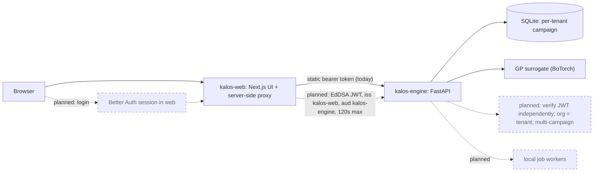

# Kalos engine

[](https://github.com/itsbrendandang/kalos-engine/actions/workflows/ci.yml)

> **Status: under development. Not a public SaaS.**
> Kalos is a scientific optimization platform being built toward a public SaaS.
> There is no hosted service today. User login and organisation management are under development and are **not** on `main`.
> The optimizer is **not scientifically validated** (see [Scientific methodology](#scientific-methodology-and-benchmark-limitations)).
> Nothing here claims enterprise readiness, regulatory compliance, or security certification.

## Overview

Kalos proposes the next batch of experiments for a bioprocess campaign.
You give it a run sheet (CSV, TSV, or Excel) of past runs and a target column, such as titer or yield.
It checks the data, fits a Gaussian-process surrogate (BoTorch), and returns a proposed batch of recipes plus the diagnostics needed to judge how far to trust them.
You then run those experiments, log the measured results, and ask for the next batch.
A separate scale-up readout predicts performance at a larger scale, and refuses when its own backtest does not support a prediction.

This repository is the **engine**: a FastAPI service with no built-in UI.
The workbench UI is the separate [kalos-web](https://github.com/itsbrendandang/kalos-web) repo.

## Target users and use cases

Intended users (the product is not yet available to external users):

- **Bioprocess scientists and process-development teams** with a spreadsheet of runs (media, feeds, pH, temperature) who want a suggested next round and an honest read on what the data can support.
- **Small teams running iterative campaigns** (propose, measure, re-propose) with a few dozen to a couple of thousand runs. The exact GP is capped at 2,000 fit rows (`KALOS_MAX_FIT_ROWS`).
- **Platform or ML engineers** who want a tenant-aware optimization API they can self-host.

Use cases: next-batch proposals for media or process optimisation; tracking an in-flight campaign; a scale-up readout from a multi-scale run sheet.
Not a use case yet: regulated (GxP) work, or anything that depends on the optimizer being validated against real wet-lab outcomes.

## Capabilities

Labels: **IMPLEMENTED** = on `main` with tests; **EXPERIMENTAL** = on `main` or in an open PR but not validated, or opt-in; **PLANNED** = not built.
Open PRs are listed as in-progress, not as implemented.

| Capability | Status | Evidence |
| --- | --- | --- |
| Upload CSV/TSV/Excel, validate, analyse, propose next batch (`POST /api/run`) | IMPLEMENTED | `kalos/portal/app.py`, `docs/UPLOADS.md`, `tests/test_validation_gate.py` |
| GP surrogate (BoTorch), mixed continuous + categorical spaces | IMPLEMENTED | `kalos/core/`, `tests/test_data_and_core.py` |
| Grouped CV, split-conformal bands, fail-closed promotion gates | IMPLEMENTED | `kalos/core/splits.py`, `conformal.py`, `gates.py`; `tests/test_calibration.py`, `tests/test_promotion_and_baselines.py` |
| Data validation gate (units, bounds, duplicates, missingness) | IMPLEMENTED | `kalos/validation/`, `tests/test_validation_gate.py` |
| Propose-measure-re-propose campaign loop with in-flight points | IMPLEMENTED | `kalos/portal/campaign_routes.py`, `docs/CAMPAIGN_LOOP.md`, `tests/test_pending_proposals.py` |
| Scale-up readout that refuses when its backtest fails | IMPLEMENTED (synthetic evidence only) | `kalos/portal/scale_routes.py`, `docs/SCALE_READOUT.md`, `docs/SCALE_EVIDENCE.md` |
| Bearer-token auth with `read`/`write`/`admin` scopes, hashed tokens | IMPLEMENTED | `kalos/portal/auth.py` |
| Tenant-keyed campaign (SQLite) and latest-analysis store | IMPLEMENTED | `kalos/portal/campaign.py`, `docs/HARDENING.md` Phase 1b |
| Upload caps, loopback-only default, remote refusal when open | IMPLEMENTED | `kalos/portal/uploads.py`, `__main__.py`, `app.py` middleware |
| Container deploy pack and CI image boot test | IMPLEMENTED (limited verification, see runbook) | `deploy/`, `.github/workflows/ci.yml` |
| Optimizer beats LHS/random on synthetic surfaces | IMPLEMENTED as a benchmark; not validation | `BENCHMARK.md`, `python -m kalos.bench` |
| Mechanistic (Monod) prior mean | EXPERIMENTAL, open PRs [#76](https://github.com/itsbrendandang/kalos-engine/pull/76), [#81](https://github.com/itsbrendandang/kalos-engine/pull/81) | not on `main` |
| Pool-replay benchmark on published media datasets | EXPERIMENTAL, open PR [#77](https://github.com/itsbrendandang/kalos-engine/pull/77) | not on `main` |
| Hard linear constraints on proposals | EXPERIMENTAL, open PR [#78](https://github.com/itsbrendandang/kalos-engine/pull/78) | not on `main` |
| `feature_ranges` in analysis output; GP-default guardrail | in progress, open PRs [#80](https://github.com/itsbrendandang/kalos-engine/pull/80), [#79](https://github.com/itsbrendandang/kalos-engine/pull/79) | not on `main` |
| Repo hygiene (CODEOWNERS, SECURITY.md) and loopback-by-default compose bind | in progress, open PRs [#83](https://github.com/itsbrendandang/kalos-engine/pull/83), [#84](https://github.com/itsbrendandang/kalos-engine/pull/84) | not on `main` |
| Verifying short-lived internal JWTs from the web app (EdDSA) | PLANNED | design only; no code |
| Organisations as tenants, with membership | PLANNED | tenants today are strings on operator-provisioned tokens |
| Multiple campaigns per tenant | PLANNED | one campaign row per tenant today |
| Local background job workers (long GP fits off the request path) | PLANNED | `docs/HARDENING.md` Phase 2; today a concurrent upload gets a 503 busy answer |
| Sparse/variational surrogate beyond 2,000 rows | PLANNED | `docs/HARDENING.md` Phase 2 |
| Metrics, structured logging, alert hooks | PLANNED | `docs/HARDENING.md` Phase 3 |
| Scientific validation on independent real wet-lab data | PLANNED | not done; see below |

## Architecture

Solid arrows and boxes exist on `main`. Dashed arrows and boxes are planned and not implemented.



Today the browser talks to the Next.js app, whose server-side proxy forwards to this engine using one configured bearer token.
The web app has **no user login**, so anyone who can reach the proxy acts as that token's tenant.
The planned design adds a Better Auth session in the web app, a short-lived EdDSA-signed internal JWT (issuer `kalos-web`, audience `kalos-engine`, lifetime of at most 120 seconds) that the engine verifies on its own, organisations as tenants, multiple campaigns per organisation, and local job workers.
Details and sequence diagrams for the campaign loop: [`docs/CAMPAIGN_LOOP.md`](docs/CAMPAIGN_LOOP.md).

## Local development

Python 3.10+ (CI uses 3.12). All tools are free and open source.

```bash
python -m pip install -e .               # core, torch-free
python -m pip install -e ".[ml,portal]"  # + BoTorch and the FastAPI service
python -m kalos.portal                   # http://127.0.0.1:8050 (KALOS_HOST / KALOS_PORT to change)
```

The core install is torch-free (`numpy`, `pandas`, `scikit-learn`, `scipy`), enough for `kalos.kit`.
In a second shell, upload the synthetic example (generated by `examples/synthetic_bioprocess/make_synthetic.py`, not measured data):

```bash
curl -F file=@examples/synthetic_bioprocess/synthetic_bioprocess.csv http://127.0.0.1:8050/api/run
curl http://127.0.0.1:8050/api/latest
```

Both commands were run against a fresh install of this branch's code (`/healthz` ok; the upload returned a 10-feature analysis for 160 rows).
State is written to `~/.kalos` (override with `KALOS_STATE_DIR`).
With no tokens configured the API is open on loopback only; see Security.

Checks (same as CI):

```bash
python -m pip install -e ".[ml,portal,dev]"
ruff check kalos/ tests/ examples/
mypy
python -m pytest -q    # 804 tests collected at the time of writing
```

## API

Routes are defined in `kalos/portal/app.py`, `campaign_routes.py`, and `scale_routes.py`.
Scopes come from `kalos/portal/auth.py`.
Every tenant-scoped route reads the tenant from the authenticated token (`Principal.tenant`), never from the request.
In open mode (no tokens configured, loopback only) every caller is an anonymous `default`-tenant principal with `read`+`write`.

| Method | Path | Scope | Tenant scoping | What it does |
| --- | --- | --- | --- | --- |
| POST | `/api/run` | write | publishes result under caller's tenant | Upload CSV/TSV/Excel; returns analysis and proposed batch ([upload guards](docs/UPLOADS.md)) |
| GET | `/api/latest` | read | per tenant | Most recent analysis |
| GET | `/api/campaign` | read | per tenant (SQLite row) | Current campaign state |
| POST | `/api/campaign/start` | write | per tenant | Start a batch of proposed runs |
| POST | `/api/campaign/result` | write | per tenant | Log a measured outcome |
| POST | `/api/campaign/reanalyze` | write | per tenant | Fold results into the dataset and re-propose |
| POST | `/api/scale/readout` | write | none stored; request-scoped | Scale-up readout: prediction with interval, or refusal |
| GET | `/api/single` | read | none (built-in demo surface) | Single-objective demo loop |
| GET | `/api/multi` | read | none (built-in demo surface) | Multi-objective demo loop |
| GET | `/api/providers` | read | none | Credential status of optional provider slots (not the credentials) |
| GET | `/healthz` | none | none | Liveness |
| GET | `/readyz` | none | none | Readiness (store check) |

Contracts: [`docs/CAMPAIGN_LOOP.md`](docs/CAMPAIGN_LOOP.md), [`docs/SCALE_READOUT.md`](docs/SCALE_READOUT.md), [`docs/UPLOADS.md`](docs/UPLOADS.md).
FastAPI also serves its generated OpenAPI docs at `/docs` when the service runs.
Open PR [#76](https://github.com/itsbrendandang/kalos-engine/pull/76) changes `/readyz` to stop returning exception text; on `main` it still returns it.

## Security model

What exists today (`kalos/portal/auth.py`, `config.py`, `uploads.py`, `app.py`):

- Bearer tokens are stored as SHA-256 hashes, compared in constant time, read per request so they can be rotated without a restart. Scopes: `read`, `write`, `admin`.
- Once any token is configured, auth is enforced on every scoped route. There is no half-authenticated state.
- Campaign and latest-analysis state are keyed by tenant; the latest-analysis cache filename is sanitised against path traversal.
- Upload caps: `KALOS_MAX_UPLOAD_MB` (default 25), 100,000 CSV rows, 512 columns, 2,000,000 xlsx cells, 2,000 GP fit rows.
- Loopback guard: `python -m kalos.portal` binds 127.0.0.1 and refuses to serve unauthenticated on another interface. A middleware also refuses non-loopback peers while auth is not enforced, unless `KALOS_ALLOW_OPEN_ACCESS` is set.
- CORS is an explicit allowlist when `KALOS_CORS_ORIGINS` is set; otherwise a localhost-only default.
- Anonymiser for uploads is opt-in (`anonymize=true`).

What is missing or limited:

- **The web app has no user login, and its proxy is unauthenticated.** Do not expose kalos-web or this engine to the public internet.
- Tenants are strings in operator-provisioned tokens. There is no user directory, organisation membership, or self-service token issuance.
- The planned web-to-engine JWT scheme does not exist yet; the engine accepts only static bearer tokens.
- `/readyz` on `main` returns exception text (fix in open PR #76).
- No rate limiting, audit log, or encryption at rest. TLS is out of scope; use a reverse proxy.
- `/api/single`, `/api/multi`, and `/healthz` are not tenant-scoped (they hold no tenant data).
- The deploy pack has been exercised once end to end; its runbook still lists unverified items (backup drill).
- No independent security review or penetration test has been done. No compliance claims are made (HARDENING.md puts 21 CFR Part 11, GAMP 5, SOC 2, and ISO 27001 out of scope for this repo).

Report vulnerabilities privately; a `SECURITY.md` is proposed in open PR #83.

## Scientific methodology and benchmark limitations

**The optimizer is not scientifically validated.** No claim is made that it improves real wet-lab outcomes.

- **Method.** GP surrogate with expected-improvement-family acquisition (BoTorch), grouped CV, split-conformal intervals, fail-closed promotion gates.
- **Synthetic benchmarks (on `main`).** The `BENCHMARK.md` result below is on synthetic surfaces with known optima, which the optimizer is free to exploit. A noise-free 2-D simulation is not validation of anything about real processes.
- **Hybrid dataset.** `dataset_0.csv` (Kaggle "Fermentation optimization", proposed in open PR #76) is hybrid: 696 of 715 rows are flagged synthetic and 19 real, and the Real flag is unverified. A pool-replay result on it was weak (Spearman 0.048), so it is a smoke test only, not evidence.
- **Amii published-media benchmark (open PR [#77](https://github.com/itsbrendandang/kalos-engine/pull/77)).** Pool replay on published media datasets. After review the author retracted the earlier "2 faster / 2 slower" summary. A paired sign test with Holm correction found no detectable difference from random in a smoke run (8 seeds). Caveats: the BO arm is pool EI rather than qLogNEI, pools come from earlier optimisation campaigns (random is strong), one dataset mixes information sources, objectives are growth/absorbance not titer, the dataset licence is unresolved, and a committed 20-seed results file is still missing.
- **Mechanistic prior benchmark (open PR [#81](https://github.com/itsbrendandang/kalos-engine/pull/81)).** Monod ODE prior mean in simulation, 10 seeds. Only the oracle (correct-model) prior result survives multiple-comparison correction. The mild-prior 8/10 result is not significant once corrected over the four levels. Severe and adversarial priors show no benefit. Remaining caveats: no observation noise, no calibration check, and the 95%-of-best metric normalises over held-out rows. The prior is opt-in and off by default.
- **Scale-up readout.** Evidence is from a synthetic simulator (`docs/SCALE_EVIDENCE.md`); the refusal rule is the safeguard, not a validation of predictions.

Synthetic benchmark from [`BENCHMARK.md`](BENCHMARK.md), simple regret after 18 experiments, 10 seeds (lower is better):

| Surface (synthetic) | Noise | BO regret | LHS regret | Random regret |
| --- | --- | --- | --- | --- |
| Gaussian bump (4d, smooth) | 0% | 0.014 | 2.247 | 3.171 |
| Gaussian bump (4d, smooth) | 15% | 1.676 | 2.247 | 2.592 |
| Ackley (4d, rugged) | 0% | 1.489 | 3.625 | 3.696 |
| Ackley (4d, rugged) | 15% | 3.572 | 3.625 | 3.850 |

Reproduce with `python -m kalos.bench` (needs the `ml` extra). The gap closes as noise rises.

### Built-in safeguards

- Cross-validation is grouped so a recipe never straddles train and validation: `kalos/core/splits.py`, with the leakage tripwire exercised in `tests/test_data_and_core.py`.
- Promotion gates fail closed, and a failing gate blocks promotion: `kalos/core/gates.py`, `tests/test_promotion_and_baselines.py`.
- Predictions carry distribution-free split-conformal bands: `kalos/core/conformal.py`, `tests/test_calibration.py`.
- A data validation gate checks units, physical bounds, duplicates, missingness, and more before any column is used, and proposals stay physically possible: [`docs/UPLOADS.md`](docs/UPLOADS.md), `tests/test_validation_gate.py`.
- Runs that are started but not yet measured are passed to the acquisition as in-flight points, so a mid-round re-proposal does not repeat them: `tests/test_pending_proposals.py`, `python -m kalos.bench --pending`, [`BENCHMARK.md`](BENCHMARK.md).
- The scale-up readout refuses to predict when its backtest on your own scale ladder does not beat two naive baselines: [`docs/SCALE_READOUT.md`](docs/SCALE_READOUT.md), `tests/test_scale_readout.py`.
- Every analysis response carries `seed` and `engine_version`, and the analyze path is seeded so the same upload gives the same proposals: `tests/test_hardening.py`.

## Current limitations

- No validated real-data win; no independent wet-lab confirmation.
- Single campaign per tenant; no user or organisation management.
- Exact GP only; capped at 2,000 fit rows. Analysis runs on the request path and a concurrent upload gets 503 busy.
- Scale-up readout evidence is synthetic.
- State is local files and SQLite; no HA, no managed backups beyond the compose sidecar (its drill was not exercised).

## Roadmap

- **MVP (toward a public beta, not started unless noted):**
  IMPLEMENTED: upload, analysis, campaign loop, scale readout, token auth, tenant-keyed store.
  IN PROGRESS (open PRs): #76-#81, #83, #84.
  PLANNED: web login (Better Auth), engine-side JWT verification, organisations as tenants, multiple campaigns, local job workers, a rate limit.
- **Later (PLANNED):** sparse/variational surrogate, metrics and alerting, server-side PDF readouts (`TODOS.md`), independent validation on real data, an external security review.
- **EXPERIMENTAL:** mechanistic priors, alternative surrogates (must beat the GP on published datasets first; PR #79).

## Deploy and operate

The deploy pack in `deploy/` has a container image per service, a `compose.yaml`, and a SQLite backup sidecar.
The engine binds to loopback by default and refuses to serve unauthenticated on any other interface.
Auth is bearer tokens configured with `KALOS_AUTH_TOKENS`; copy `deploy/.env.example` and fill it in.
The runbook says what is and is not verified: a first deployment on 2026-09-10 ran the stack end to end, but its own "NOT verified" list still says no image was built and no container was run, and the backup drill was not exercised.
CI builds the engine image and waits for its healthcheck on every push.
TLS is out of scope: put a reverse proxy in front. Full steps: [`deploy/RUNBOOK.md`](deploy/RUNBOOK.md).
Because the web UI has no login, treat any deployment as private-network only. Open PR #84 makes the web port loopback by default.

## Extending to other domains

The optimization engine (`kalos/core/`) and the upload and validate pipeline are domain-neutral.
Biology lives in `kalos/domains/` as data, not code in the engine.

- Declare a `ColumnRoles` schema (target, features, categoricals, groups, ids), or pass the `roles` JSON field to `POST /api/run`, and the analysis runs under the generic profile.
- Mixed continuous and categorical design spaces fit a BoTorch `MixedSingleTaskGP` and propose with `optimize_acqf_mixed`.
- To target a new domain, copy `kalos/domains/generic.py` into a new profile.
  Nothing in `core/` changes.

## Data policy

No client or proprietary data lives in this repo.
The examples and tests use synthetic data, and synthetic data is always labeled as such.
The anonymizer (`anonymize=true` on upload) is opt-in.

## Stack and cost

The whole stack is free and open source: Python, FastAPI, BoTorch/PyTorch, SQLite, Next.js, GitHub Actions. Local development needs no paid service. Optional external-provider slots (`/api/providers`) and the optional LLM header-normalisation tier (`normalize` extra) use paid APIs only if you supply keys; neither is required.

## Repository layout

- `kalos/core/`: the BoTorch surrogate, acquisition, grouped CV, conformal bands, and gates.
- `kalos/kit/`: torch-free facade over the splits, drivers, conformal, gates, and anonymizer.
- `kalos/validation/`: the data-quality checks and their report.
- `kalos/normalize/`: unit registry and header-to-column mapping.
- `kalos/scale/`: scale-up features, transfer, and leave-one-scale-out evaluation.
- `kalos/domains/`: declared column roles and domain profiles.
- `kalos/portal/`: the FastAPI service.
- `kalos/bench/`: the benchmark harness.
- `kalos/data/`, `kalos/features/`, `kalos/providers/`: anonymizer, optional feature embedders, provider credential slots.
- `deploy/`: container files, compose, backup sidecar, runbook.
- `docs/`: API contracts and evidence.
- `examples/`: demos and synthetic data sets.
- `experiments/`: off-path research prototypes, not part of the package or its guarantees.
- `tests/`: pytest suite.

## Contributing

- One focused pull request per change; conventional commits (`feat:`, `fix:`, `docs:`, `chore:`).
- Run the checks above (`ruff`, `mypy`, `pytest`) before opening a PR; update `CHANGELOG.md` with the code.
- Use synthetic data only; never commit client or proprietary data, secrets, or tokens.
- Do not describe a result as validated unless it was measured on independent data and reported with its caveats.
- PR descriptions should state what is implemented, what is incomplete, tests run, security impact, and dependencies.

## License

Apache-2.0. See [`LICENSE`](LICENSE).

## About the author

Brendan Dang.
Founder-operator in biotech process optimization, now an ML engineer.
[github.com/itsbrendandang](https://github.com/itsbrendandang)
