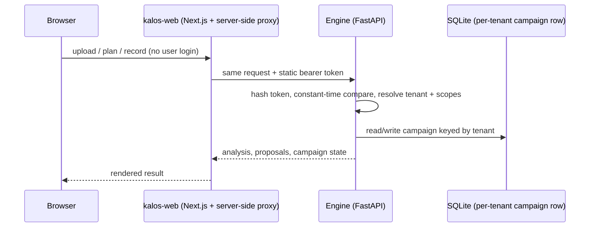

# Architecture

Status: today's system plus a clearly marked planned design. Nothing marked "planned" is implemented.

## Today (on `main`)



- Identity: operator-provisioned bearer tokens (`kalos/portal/auth.py`). Tenant = a string on the token.
- Persistence: `<KALOS_STATE_DIR>/portal.db` (default `~/.kalos`), one campaign row per tenant (`kalos/portal/campaign.py`); latest analysis in memory plus a per-tenant JSON cache.
- Compute: the GP fit runs in the request. A second concurrent upload gets a 503 busy answer (`kalos/portal/busy.py`).

## Planned (not implemented)

```mermaid
sequenceDiagram
  participant B as Browser
  participant W as kalos-web
  participant E as Engine
  B->>W: sign in (Better Auth session)
  W->>W: resolve user + active organisation
  W->>E: request + EdDSA JWT (iss kalos-web, aud kalos-engine, lifetime <= 120 s)
  E->>E: verify signature, iss, aud, exp independently; organisation = tenant
  E-->>W: result (long fits handed to local job workers)
```

Open design questions: key distribution and rotation for the EdDSA key, organisation-to-tenant mapping, per-organisation multiple campaigns, and the job-worker lifecycle.
