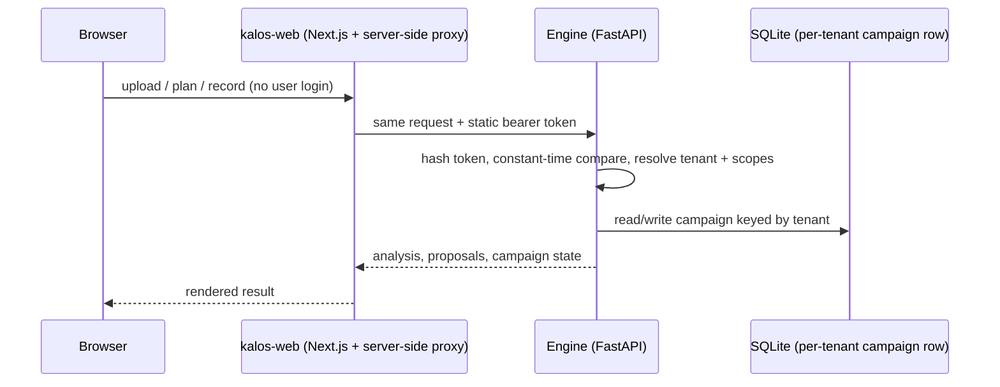
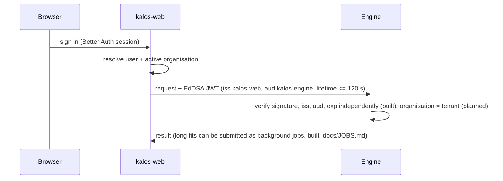

# Architecture

Status: today's system plus a clearly marked planned design. Nothing marked "planned" is implemented.

## Today (on `main`)

- Identity: operator-provisioned bearer tokens (`kalos/portal/auth.py`), plus engine-side verification of EdDSA engine JWTs (`kalos/portal/jwt_auth.py`, `docs/ENGINE_TOKEN.md`). Tenant = a string on the token or the JWT `tenant` claim.
- Persistence: `<KALOS_STATE_DIR>/portal.db` (default `~/.kalos`, schema v3), several campaigns per tenant (`kalos/portal/campaign.py`, `docs/CAMPAIGNS_API.md`); the legacy routes act on one default campaign per tenant. Latest analysis in memory plus a per-tenant JSON cache.
- Compute: the GP fit runs in the request, or as a background job in a local worker process (`kalos/portal/jobs.py`, `docs/JOBS.md`). A second concurrent synchronous upload gets a 503 busy answer (`kalos/portal/busy.py`).

## Planned web side (engine side is built)

Not yet built: the web-side sign-in and JWT issuance (the web app still sends one static bearer token), and organisations as tenants with membership.

Open design questions: key distribution and rotation for the EdDSA key, and organisation-to-tenant mapping and membership.
